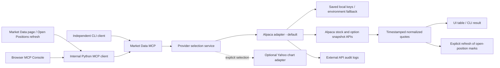

# Market Data MCP: Alpaca Default And Optional Yahoo Quotes

Updated November 1, 2026. Alpaca is the default market-data source. Existing saved Alpaca keys and feeds are reused. Yahoo Finance remains the Stock News source; its quote adapter is an optional alternative. The October 20 Yahoo-default experiment is historical.

MCP endpoint `/market-data-mcp/`, tools `get_market_data_capabilities`, `get_equity_snapshots`, `get_option_snapshots`, resource `market-data://capabilities`, and prompt `market_data_health_check` are unchanged for web, console, and CLI clients.

## Request Workflow



## Setup And Demo

1. Start the server. Configure keys under `Configuration > Market Data Settings > Manage Alpaca Keys` if needed; existing keys are preserved.
2. Open `Portfolio > Market Data` to retrieve quotes for open and closed portfolio symbols.
3. Inspect provider, source timestamp, feed, and status. Use Open Positions > Refresh Quotes via MCP to persist position marks.

If a shell previously selected Yahoo, explicitly select Alpaca and restart:

```bash
export TRADING_JOURNAL_MARKET_DATA_PROVIDER=alpaca
python3 -m uvicorn app.main:app --host 127.0.0.1 --port 8000
```

Independent client demonstration:

```bash
python3 scripts/mcp_demo_client.py --server market discover
python3 scripts/mcp_demo_client.py market-check --symbols AAPL,MSFT
```

If demo password protection is enabled, use the authentication options in [README_Public.md](../README_Public.md).

## Data Semantics And Limits

- Stocks and ETFs use Alpaca `/v2/stocks/snapshots`; options use `/v1beta1/options/snapshots`.
- Key ID and secret are sent in Alpaca authentication headers, never in MCP tool arguments. The browser masks saved key status.
- The default `iex` stock feed covers IEX exchange activity, not a consolidated US market feed. A configured `sip` feed requires suitable access.
- The default options feed is `indicative`; these rows are labeled `INDICATIVE`. An OPRA feed requires appropriate access. Do not interpret indicative prices as executable exchange quotes.
- The app requests snapshots on demand. It does not subscribe to continuous WebSocket streaming or automatically poll.
- `As Of` comes from provider data. When markets are closed, a successful response can reflect a previous session.
- Bid/ask is displayed when returned. Stock marks prefer the latest trade; option marks prefer a bid/ask midpoint, falling back to the last trade.
- Missing symbols remain unavailable. API authentication, entitlement, rate-limit, and connection failures produce errors; the app does not silently switch providers.
- Currency mismatches, when returned, block automatic mark application. FX conversion is not implemented.
- Individual bond quotes and mutual-fund NAV lookup remain unsupported. Stored position marks are not a historical quote archive.
- Quote persistence, stale-data thresholds, caching, and broader production-feed validation remain roadmap work.

## Optional Yahoo Quote Provider

Select `TRADING_JOURNAL_MARKET_DATA_PROVIDER=yahoo` and restart only if Yahoo demo quotes are desired. No Yahoo API keys are required. The adapter uses the public chart endpoint through HTTPX, returns `SNAPSHOT` rows with `regularMarketTime`, and leaves bid/ask blank. Options depend on contract chart availability; data may be delayed.

This quote setting is independent of `TRADING_JOURNAL_NEWS_PROVIDER`, which remains `yahoo` by default. There is no automatic fallback between Yahoo and Alpaca.

## Code Responsibilities

| File | Responsibility |
|---|---|
| `app/config.py` | Defaults quote provider to `alpaca` and news provider to `yahoo` |
| `app/providers/market_data/alpaca.py` | Alpaca adapter delegating to the retained implementation |
| `app/services/market_data.py` | Provider dispatch, Alpaca requests/normalization/audit, MCP client flow, table rows, mark refresh |
| `app/services/market_data_settings.py` | Saved Alpaca settings, masking, environment fallback |
| `app/providers/market_data/yahoo.py` | Optional chart adapter, per-symbol errors, source timestamps |
| `app/mcp_servers/market_data.py` | Provider-neutral tools, resource, and prompt |
| `app/templates/market_data_settings.html` | Active provider and Alpaca configuration link |
| `scripts/mcp_demo_client.py` | External MCP discovery and quote lookup |

## References And Materials

- [Alpaca Market Data API](https://docs.alpaca.markets/us/docs/about-market-data-api): authentication and feed coverage.
- [Yahoo chart reference](https://github.com/ranaroussi/yfinance/blob/main/yfinance/scrapers/history.py): optional Yahoo request pattern. This app uses HTTPX directly, not yfinance.
- [Documentation index](README.md), [current Alpaca presentation](presentations/trading_journal_mcp_alpaca.pptx), [technical white paper](mcp_use_case_white_paper.md), and [proposal addendum](proposal/market_data_implementation_addendum.md).
