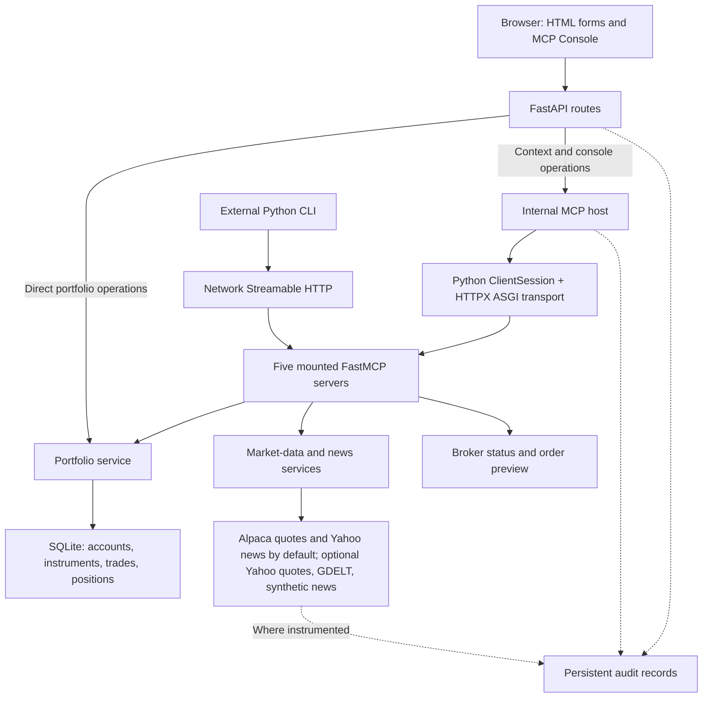
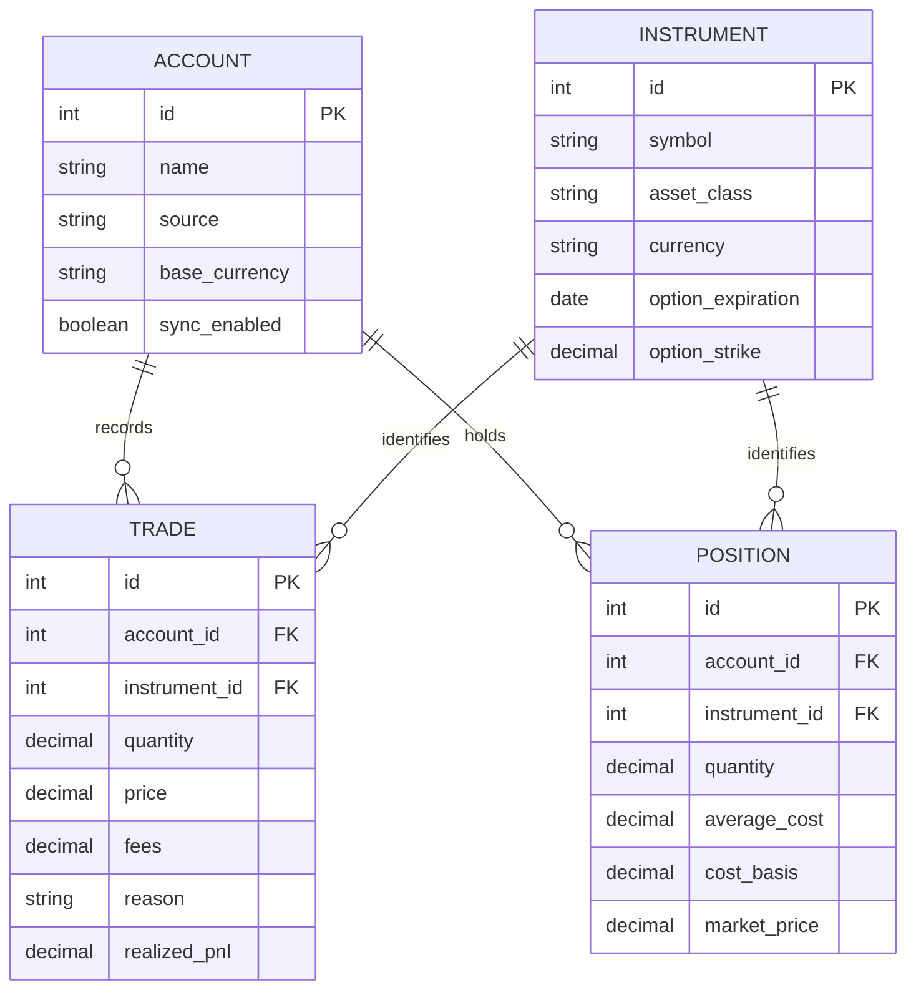
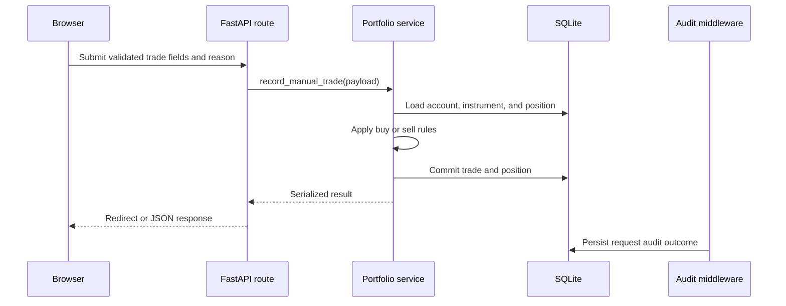
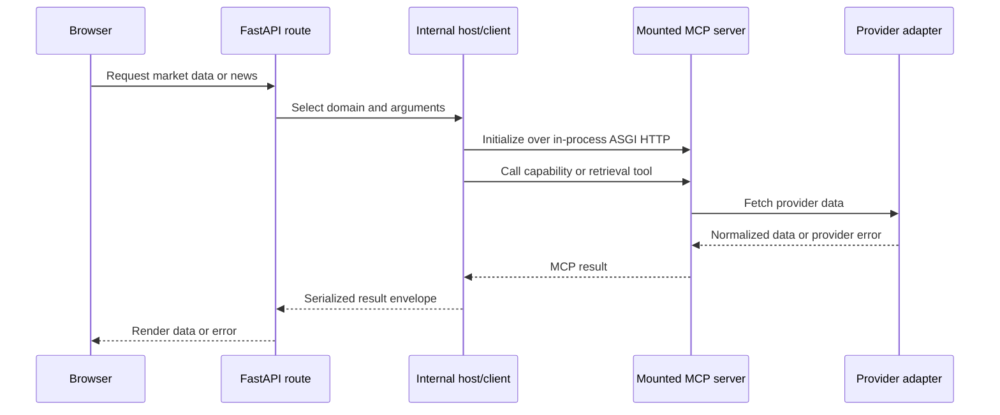
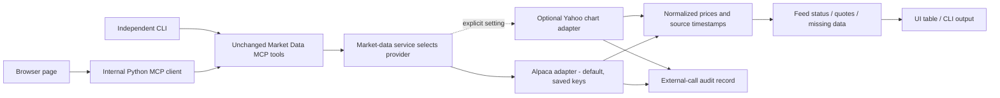

# Trading Journal MCP: An Auditable Portfolio Application as a Model Context Protocol Case Study

Author: Deepak Singla (project owner; authorship and affiliation require author review)

Date: November 1, 2026

Revision: 2.2, Alpaca default restored; Yahoo quotes remain optional. Implementation descriptions reflect the working tree inspected on this date, including uncommitted project changes. The accepted proposal remains historical; see `docs/proposal/market_data_implementation_addendum.md` for the provider-change record.

Document type: ACM-style technical white paper. This is a project manuscript, not an accepted or published ACM paper. Venue-specific formatting, author metadata, rights statements, and submission declarations must be supplied before submission.

## Abstract

Trading Journal MCP is a Python application that combines portfolio accounting and trade reasoning with discoverable Model Context Protocol (MCP) capabilities. A FastAPI application hosts a browser interface, an internal MCP client, and five domain-specific MCP servers. An external command-line client exercises the same protocol interfaces. The implementation demonstrates tools, resources, prompts, provider adapters, and persistent audit logging within a financial software case study. Manual portfolio routes access application services directly, while market-data, news, and console workflows use MCP. This paper describes that distinction, documents implementation boundaries, and provides a reproducible functional evaluation procedure. Broker connectivity is scaffolded and trading is preview-only. The work establishes a concrete educational example of protocol reuse across clients; it does not establish production readiness, improved investment performance, or a measured advantage over REST.

## Keywords

Model Context Protocol; portfolio management; trading journal; interoperability; audit logging; software architecture

## Reading Guide

Sections 1-8 introduce the problem, architecture, evaluation approach, and conclusions. Sections 9-18 provide the detailed engineering analysis: requirements, protocol lifecycle, the complete capability inventory, data semantics, request sequences, provider contracts, observability, security, experimental design, and deployment. Appendices supply an executable demonstration guide, source traceability, glossary, and publication checklist. Descriptions marked **implemented** are supported by inspected source; **observed** refers to a reported local check; **proposed** denotes work that has not been completed.

## 1. Introduction

A trading journal connects quantitative state, such as position quantities and profit/loss, with the reasons a person records for entering and leaving trades. Integrating market data and news adds another concern: each provider introduces its own credentials, data model, errors, and coverage limits. Exposing that functionality separately to a browser and an external client can duplicate integration logic.

This project explores whether focused MCP interfaces can make the same application capabilities accessible to multiple clients while keeping accounting and provider logic in services. MCP specifies a host/client/server architecture and capability negotiation [1]. Trading Journal applies those concepts to a local portfolio application rather than evaluating autonomous financial decision-making.

The contributions are an implemented domain decomposition, an explicit comparison of direct and MCP-mediated request paths, a traceability design, and a reproducible functional evaluation plan. Claims are limited to behavior demonstrable in the repository.

## 2. Protocol Background and Design Alternatives

An MCP host coordinates clients; a client connects to a server exposing capabilities. Tools represent callable operations, resources expose application context, and prompts provide reusable message templates [1, 2]. A prompt template does not itself invoke a language model. This application's workflows can operate without an LLM.

The project uses the MCP Python SDK [3] and Streamable HTTP. Its browser communicates with FastAPI rather than negotiating MCP in JavaScript. Python client sessions perform initialization and operations. For internal calls, an HTTPX ASGI transport dispatches to the same application in-process. An external CLI uses the mounted HTTP endpoints over a network connection.

REST endpoints or direct Python calls remain reasonable alternatives. Direct service access is simpler for local forms; MCP adds initialization, schemas, and session handling but offers protocol-level discovery to compatible clients. No controlled REST comparison has been performed, so this paper makes no comparative performance or productivity claim.

## 3. System Design

### 3.1 Application and Persistence

FastAPI routes render Jinja2 pages and expose JSON APIs. SQLAlchemy models persist local application state in SQLite. Portfolio services manage opening holdings, manual buys and sells, partial and full closes, average-cost position updates, and realized/unrealized P&L. Manual trades require a reason. These rules are deterministic for a fixed input and stored state; external quotes vary with observation time.

### 3.2 Domain Interfaces

| MCP server | Endpoint | Current responsibility |
|---|---|---|
| Trading Journal | `/mcp/` | Accounts, positions, trades, opening holdings, portfolio summary |
| Market Data | `/market-data-mcp/` | Provider capabilities and equity/option snapshots |
| News | `/news-mcp/` | Symbol and portfolio news, capabilities, review prompts |
| Broker | `/broker-mcp/` | Placeholder broker status and account capability scaffolding |
| Trading | `/trading-mcp/` | Trading capabilities and order preview |

The five interfaces are mounted within one application. Logical server separation does not imply deployment isolation, independent databases, or independently enforced authorization boundaries. Server registration lives in `app/services/mcp_host.py`; server implementations reside in `app/mcp_server.py`, `app/market_data_mcp.py`, and `app/mcp_servers/`. All five factories use `stateless_http=True` and `json_response=True`. The clients still initialize protocol sessions, but the servers do not maintain persistent HTTP session state for an individual user.

### 3.3 Provider Adapters

Market-data functionality selects `AlpacaMarketDataProvider` by default as of November 1, 2026, reusing saved API keys and selected feeds. The service preserves the MCP tools, resource, prompt, and endpoint. Yahoo chart quotes remain optional through `TRADING_JOURNAL_MARKET_DATA_PROVIDER=yahoo`; no keys are needed for that adapter. The October Yahoo-default experiment and November restoration demonstrate provider substitution behind the same MCP contract. Both paths retrieve requested snapshots rather than continuous streams. The optional Yahoo request pattern follows the chart reference [11]; this app uses HTTPX directly. Alpaca authentication and feed coverage are documented by the provider [13].

News configuration separately supports Yahoo Finance, GDELT, and a synthetic demo provider. Yahoo remains the default for news, using a separate public-search adapter. Both Yahoo integrations are demonstration sources, not production guarantees. Coverage, source terms, rate limits, freshness policies, and persistent quote/news caching remain areas for further work [12].

### 3.4 Traceability

Correlation IDs connect requests to internal MCP operations. Persistent logs cover user requests, MCP operations, application events, and supported external calls. A redaction helper removes recognized secret fields before storage; a browser audit viewer exposes recent records. The design supports investigation, but does not establish tamper evidence, complete domain-event coverage, retention compliance, or production observability. Yahoo market-data requests log successful and failed calls, including missing symbols, invalid responses, and rate limits. Alpaca external-call logging remains active for the default path; coverage must still be checked for each additional provider.

## 4. Representative Workflows

### 4.1 Manual Trade Entry

The browser submits a trade form to FastAPI. Validation precedes portfolio service execution. The service writes trade and position state to SQLite, and the response redirects or renders a validation error. This path accesses services directly. The portfolio MCP tools expose related operations for external clients without requiring local forms to call MCP.

### 4.2 Market Data and News

The route collects symbols and creates an internal MCP operation. The Python client initializes a session, calls the selected tool, and receives structured results. The MCP server delegates to its service/provider; the route renders the response. Yahoo requires no API keys. Optional-provider credential failures, unavailable symbols, and external request failures remain distinct from valid results. A mixed Yahoo batch preserves successful quotes and reports errors per symbol. These operations retrieve context; they do not submit orders.

### 4.3 Console and External Client

The browser console supports catalog discovery, tool invocation, resource reads, and prompt rendering. The CLI provides an external client demonstration. Both consume MCP capabilities, although transport dispatch differs. The Workflow Map at `/workflow` documents these paths, endpoint roles, and implementation limits.

### 4.4 Preview Boundary

`preview_order` returns a preview result. Broker account synchronization, paper trading, and live execution are not completed capabilities. A preview must not be interpreted as broker acceptance, execution, or an authorization gate for a separate trading system.

## 5. Evaluation Method

The evaluation is functional and repository-based. It does not include a user study, throughput benchmark, reliability study, or investment-return experiment. Use an isolated test database and synthetic holdings; external provider behavior should be mocked in automated checks.

From the project root, install development dependencies and run:

```sh
python -m pip install -e '.[dev]'
python -m pytest -q
python -m uvicorn app.main:app --host 127.0.0.1 --port 8000
```

The development server command assumes the exported `app` in `app/main.py`. Use a free port if needed. For external discovery, consult `python scripts/mcp_demo_client.py --help` and run its `discover` command against the running instance.

| Research question | Evidence and acceptance condition |
|---|---|
| Can clients discover domain capabilities? | `tests/test_mcp_flow.py`: initialized sessions expose expected tools and resources across mounted servers. |
| Can a client modify and read portfolio state? | Synthetic opening holding and sale are reflected through tools and portfolio resources. |
| Are provider responses represented consistently? | Mocked market data preserves returned and missing symbols and capability metadata. |
| Does the trading interface preserve its boundary? | Capability response disables live trading; order result remains `preview_only`. |
| Is traceability protected against obvious credential disclosure? | Audit tests exercise correlation IDs and secret redaction. |
| Does the learning screen match implementation? | Workflow route tests verify direct service paths, internal ASGI transport, and scaffold limitations. |

Automated test output is the evidence for a particular checkout and environment; a passing suite does not prove complete coverage. Section 17 records the dated verification result, which must be refreshed when the checkout changes. No fabricated measurements or participant results are reported.

## 6. Discussion and Limitations

The case study demonstrates capability reuse across a browser host and an external MCP client. Separating domain services from transport also permits local routes to remain simple. However, hosting clients and servers in one process limits conclusions about distributed behavior. Internal ASGI tests do not establish TLS behavior, reverse-proxy compatibility, remote authorization, or failure recovery over real networks.

Average-cost accounting supports the implemented journal workflow; it is not a complete tax-lot or brokerage reconciliation system. Asset-class labels do not prove full valuation support for every instrument. Authentication, user ownership, migrations, concurrency, backups, audit retention, and provider licensing require further work before shared production deployment. Financial recommendations and automated strategy decisions are outside the evaluated implementation.

## 7. Ethics, Authorship, and Reproducibility

Use synthetic account data for demonstrations and publication artifacts. Do not publish credentials, identifiable brokerage records, or raw private trade reasons. Quotes and news remain subject to the providers' terms and entitlements. Logs can contain sensitive financial context even when API secrets are redacted.

Human authors must review technical claims, references, attribution, and institutional requirements. AI assistance was used to draft this manuscript and associated implementation changes; it is not listed as an author. The named project owner must confirm authorship, affiliation, contribution statements, and any required disclosure before submission. ACM policy and venue instructions should be checked directly [4, 5]. No ACM acceptance, ethics approval, participant consent, funding, or conflict declaration is implied.

Reproduction should record the Git revision, Python version, installed dependencies, test output, provider/feed configuration without secrets, and whether data was mocked. The repository currently uses dependency ranges rather than a fully pinned experiment environment, which limits exact dependency reproduction.

## 8. Findings and Future Work

Trading Journal provides a concrete MCP case study with portfolio tools, provider-backed context, multiple clients, and persistent audit foundations. Its contribution is an inspectable application architecture and functional demonstration. Next steps include broader audit coverage, stored market/news data, user isolation, deployment validation, and broker reconciliation before order execution. Comparative evaluation against direct APIs and structured usability testing would be needed to support stronger claims.

## 9. Problem Definition, Requirements, and Research Questions

### 9.1 The Domain Problem

The user needs to answer several related questions: what is held, where it is held, what it cost, what has been realized, what remains unrealized, and why a transaction was recorded. Market data and news add context but have different lifecycles from a journal entry. A trade is durable user-entered history; a quote is an observation that becomes stale; a headline is external text whose relevance is uncertain. A useful integration must preserve these differences.

The original product ambition includes multiple asset classes and brokerage-like portfolio views. The implemented prototype addresses a narrower slice: local account and position tracking, manual holdings and trades, basic P&L, provider-backed context, and MCP demonstrations. A label such as `IBKR Live` in the local database identifies a seeded account; it does not prove a broker connection or that account information was obtained from IBKR.

The technical problem is therefore not simply to place an MCP endpoint in front of a database. It is to define reusable operations with clear validation and effects, keep financial calculations consistent across entry points, represent external-data limitations, and make requests explainable after execution.

### 9.2 Stakeholders and Use Cases

| Stakeholder | Primary task | Evidence the system should expose |
|---|---|---|
| Individual journal user | Record holdings and reasons, review P&L | Trades, position balances, mark prices, reasons |
| Instructor or evaluator | Understand MCP using a working application | Workflow Map, catalogs, CLI output, audit viewer |
| Application developer | Add a provider or client | Service interfaces, schemas, tests, correlation IDs |
| External MCP client operator | Discover and invoke supported capabilities | Tool schemas, resources, prompts, structured results |
| Future shared-service administrator | Control ownership and access | Proposed identity, authorization, retention, and deployment controls |

The final stakeholder is prospective. Current source does not establish a complete shared-service administration model.

### 9.3 Functional Requirements and Boundaries

| ID | Requirement | Implementation boundary |
|---|---|---|
| FR1 | Persist accounts, instruments, trades, and positions | Local SQLAlchemy/SQLite models |
| FR2 | Require a reason for manual trades | Request schemas and portfolio tool validation |
| FR3 | Support opening holdings and subsequent buys/sells | Existing import and portfolio services |
| FR4 | Expose portfolio capabilities to another client | Portfolio MCP tools and resources |
| FR5 | Retrieve quote and news context | Provider-backed MCP domains; external availability varies |
| FR6 | Discover tools, resources, and prompts | Browser host and CLI discovery |
| FR7 | Trace requests and redact recognized secrets | Persistent audit foundation |
| FR8 | Demonstrate broker and trading boundaries | Status scaffold and preview-only order tool |
| FR9 | Explain the application architecture | `/workflow` and this manuscript |

Nonfunctional objectives are maintainability, predictable validation, inspectability, and reproducibility. These are design objectives rather than quantified service-level guarantees. The project has not established an availability target, maximum safe concurrency, latency budget, recovery-point objective, or measured educational learning gain.

### 9.4 Research Questions

**RQ1: Capability reuse.** Can portfolio and context operations be exposed through domain MCP servers and exercised by both an internal client and an external CLI?

**RQ2: Separation of concerns.** Can protocol handling remain outside accounting rules and provider-specific response parsing?

**RQ3: Observability.** Can the application connect a browser action to internal MCP operations and selected external API calls without storing obvious credential fields?

**RQ4: Boundary communication.** Can an educational interface distinguish functioning integrations from placeholders, previews, and future plans?

**RQ5: Tradeoffs.** Which costs are introduced by MCP, particularly initialization, serialization, error handling, and audit writes, and which require further measurement?

Functional tests address parts of RQ1-RQ4. RQ5 is primarily an architectural analysis until a controlled performance experiment is conducted.

## 10. Protocol Lifecycle and Runtime Architecture

### 10.1 Components and Responsibilities



Figure 1. Logical component diagram. All mounted servers currently share one application process and local persistence environment. Dotted arrows denote audit paths, whose coverage differs by component.

### 10.2 Initialization and Discovery

The internal host resolves a server identifier through a fixed registry, creates an HTTPX client, enters `streamable_http_client`, constructs `ClientSession`, and calls `initialize()`. It then performs the requested operation and closes the contexts. Catalog discovery calls `list_tools()`, `list_resources()`, and `list_prompts()` and returns normalized metadata to the browser.

The registry is application configuration, not an external service-discovery system. Adding an endpoint does not automatically make it trusted. The current design resolves known server IDs rather than accepting an arbitrary server URL from a console request. The CLI separately permits an explicit endpoint override, so its operator controls that destination.

MCP architecture and the application implementation must be distinguished. Protocol documentation describes host/client/server roles [1]; the local host implements a practical subset of those responsibilities. It is not an audited permission broker, agent sandbox, or complete policy engine.

### 10.3 Stateless HTTP and Logical Sessions

Each server factory sets `stateless_http=True`, `json_response=True`, and `streamable_http_path="/"`, with its application mount supplying the public prefix. A client-side session object is still used to initialize and exchange protocol messages. That object should not be confused with a durable authenticated user session or a server-maintained conversation.

The project does not implement persistent conversation memory, resumable event delivery, or a subscription-driven portfolio feed. It also does not demonstrate every optional MCP feature. Streamable HTTP is the selected protocol transport [6]; neither JSON responses nor use of the SDK establishes conformance to all optional behaviors in the specification.

### 10.4 In-Process and External Transport

Internal calls use `httpx.ASGITransport(app=app)` and registered loopback-shaped URLs. The URLs select mounted routes, but traffic is dispatched in-process. Consequently, internal market-data and news pages do not need to connect to port 8000 as a network listener even when their registry strings contain that port.

The external CLI makes real HTTP requests. Its `--base-url` must match the running server, for example `http://127.0.0.1:8018`. This distinction explains why an internal MCP test can pass while a browser or external CLI cannot reach the application: the process may be stopped, the port may differ, or the network layer may reject the connection. A route test is not a network availability check.

### 10.5 MCP, APIs, and Direct Service Calls

| Choice | Useful property in this project | Cost or limitation |
|---|---|---|
| Direct service call | Simple local form flow; shares accounting implementation | Python-specific coupling; no protocol discovery |
| JSON API | Familiar browser and integration access | Project-specific routes and client conventions |
| MCP | Catalog discovery and common tool/resource/prompt operations | Protocol initialization, envelope handling, and another failure layer |
| Separate remote MCP services | Potential independent deployment and permissions | Proposed; adds authentication, network, and operational concerns |

These options can coexist. The implementation uses direct calls for ordinary portfolio forms and MCP for context retrieval and the learning console. This is a deliberate mixed architecture, not evidence that every application action needs MCP.

## 11. Complete MCP Capability Catalog

The following inventory is derived from server decorators in the inspected source. Tools use structured output. Exact generated input/output schemas should be discovered from the running SDK because Python annotations, SDK versions, and schema generation can affect the wire representation.

### 11.1 Portfolio Tools

| Tool | Main arguments | Behavior and effects |
|---|---|---|
| `get_portfolio_summary` | None | Returns account counts, position counts, P&L, and performance breakdowns |
| `list_accounts` | None | Serializes local accounts, including source and sync flags |
| `list_positions` | Optional `account_name`, `symbol` | Returns open positions; symbol filter strips whitespace and uppercases |
| `list_trades` | `limit=25`, optional account and symbol | Returns filtered recent trades; nonpositive limits return no rows |
| `add_opening_holding` | Account, symbol, asset class, date, quantity, average cost; optional description, notes, currency | Validates a holding request, records opening state, and updates the position |
| `add_manual_trade` | Account, symbol, asset class, date, side, quantity, price, reason; optional fees, description, notes, currency | Validates and records a manual trade and updates accounting state |

Read operations do not write portfolio state, although request and MCP audit records may be written. The two mutation tools change the journal database; neither places a brokerage order. Clients should obtain account IDs from `list_accounts` rather than assume a particular seeded ID.

### 11.2 Context, Broker, and Trading Tools

| Server | Tool | Main input and output contract |
|---|---|---|
| Market Data | `get_market_data_capabilities` | Provider, configured state, feed names, notes |
| Market Data | `get_equity_snapshots` | Symbol list to equity snapshot envelope |
| Market Data | `get_option_snapshots` | Option-symbol list to option snapshot envelope |
| News | `get_news_capabilities` | Selected provider capabilities |
| News | `get_symbol_news` | Symbol and default limit 5 to article list |
| News | `get_portfolio_news` | Symbol list and default limit per symbol 3 to article list |
| Broker | `get_broker_status` | Provider configuration and scaffold status |
| Broker | `list_broker_accounts` | Provider-dependent account list or a configuration error |
| Trading | `get_trading_capabilities` | Preview true; paper and live submission false |
| Trading | `preview_order` | Draft arguments to `preview_only` result, without submission |

In total, the five factories declare **16 tools, 6 resources, and 6 prompts**. These are source inventory counts, not performance results. Deployment discovery should confirm the inventory after changes.

### 11.3 Resources

| Resource URI | Contents | Source |
|---|---|---|
| `portfolio://summary` | Current JSON summary | Portfolio service/database |
| `portfolio://positions` | Current open-position JSON list | Portfolio service/database |
| `market-data://capabilities` | Market provider configuration and limits | Capabilities reader |
| `news://capabilities` | News provider capabilities | News service |
| `broker://status` | Broker configuration/status | Broker service |
| `trading://capabilities` | Current preview/submission boundaries | Trading capability function |

These URIs identify MCP resources, not browser URLs or independently hosted websites. Resources provide current context through read operations [8]. In this implementation, portfolio resources compute a fresh view when read; they are not immutable historical snapshots. The presence of a resource does not imply subscriptions, change notifications, or a historical data archive.

### 11.4 Prompts

| Prompt | Arguments | Material assembled |
|---|---|---|
| `daily_portfolio_review` | `focus="overall"` | Summary counts and P&L plus review instructions |
| `journal_follow_up` | `account_name="Manual Entry"` | A selection of recent trade reasons plus review instructions |
| `market_data_health_check` | `symbols="SPY,QQQ"` | Provider/feed configuration plus troubleshooting questions |
| `portfolio_news_review` | `symbols="AAPL,MSFT"` | A reusable news-review instruction |
| `broker_sync_readiness` | None | Broker status plus readiness questions |
| `order_safety_review` | `symbol="SPY"` | An order-review instruction |

Prompts return messages for a client to use [9]. The application does not invoke an LLM to answer these messages. Some templates include local portfolio data; others contain only instructions and identifiers. The `journal_follow_up` implementation selects from a bounded recent-trade set before account filtering and may fall back to that set if no account match is found. It should not be described as an exhaustive account-specific journal report or used as a tenant-isolation mechanism.

### 11.5 Structured Content and Errors

The host serializes SDK results with `model_dump(mode="json")`. A dictionary result may be available directly under `structuredContent`; a list result may be wrapped under a `result` key. News extraction explicitly handles both shapes and checks `isError` before consuming content. Wire examples below are illustrative and intentionally omit SDK-dependent metadata.

```json
{
  "jsonrpc": "2.0",
  "id": 42,
  "method": "tools/call",
  "params": {
    "name": "list_positions",
    "arguments": {"symbol": "QQQ"}
  }
}
```

This is an example message after initialization, not a complete standalone HTTP exchange. Applications must interpret protocol/transport errors separately from a successful exchange containing a tool failure. MCP tool results support structured content and tool-level error signaling [7]. In particular, HTTP 200 alone is insufficient evidence that an operation achieved its business purpose.

## 12. Data Model and Accounting Semantics

### 12.1 Core Entities



Figure 2. Selected fields and logical relationships. The diagram omits timestamps, optional metadata, and the separate audit tables for clarity.

`Account` stores source and local sync flags. `Instrument` identifies the security and contains optional option-contract fields. `Trade` stores a dated event, origin, reason, fees, and realized P&L when applicable. `Position` stores an aggregate for an account/instrument pair; a database uniqueness constraint covers that pair. Numeric columns use `Numeric(18, 6)`, and Python calculations use `Decimal`.

This arrangement is an aggregate-position journal, not a complete event-sourced ledger. Position state is updated directly. Historical corrections, effective-date replays, and immutable position episodes require additional design. A contract uniqueness declaration involving nullable fields also should not be assumed to prevent every duplicate instrument across all database engines and null combinations.

### 12.2 Buy and Sell Rules

For the implemented long-position arithmetic, let `q` be existing quantity, `B` existing cost basis, `x` transaction quantity, `p` transaction price, and `f` fees. A buy updates:

```text
new_quantity = q + x
new_basis = B + x * p + f
new_average_cost = new_basis / new_quantity
```

A sell uses the previous average cost `a`:

```text
removed_basis = x * a
net_proceeds = x * p - f
realized_pnl = net_proceeds - removed_basis
remaining_quantity = q - x
remaining_basis = B - removed_basis
```

The service rejects a sale larger than the current quantity. A full close resets aggregate quantity, basis, and average cost to zero. A partial close recomputes average cost from remaining basis and quantity. A sale sets the position mark to its transaction price; a buy sets it only when no mark exists. These marks should be distinguished from a separately timestamped market-data observation.

For a mark `m`, market value is `q * m` and unrealized P&L is market value minus basis. If a nonzero position has no mark, individual market metrics can be null. Summary helpers may treat missing numeric values as zero while aggregating, so a summary total should not be interpreted as a fully priced portfolio without inspecting mark completeness.

### 12.3 Worked Example

The following synthetic example explains the implemented arithmetic. It is not a market observation or an investment suggestion.

| Step | Action | Quantity | Basis | Average cost | Realized P&L at step |
|---|---|---:|---:|---:|---:|
| 1 | Opening holding: 10 units at 100 | 10 | 1,000 | 100 | None |
| 2 | Buy 5 at 118, fee 10 | 15 | 1,600 | 106.666667 approximately | None |
| 3 | Sell 6 at 125, fee 5 | 9 | About 960 | About 106.666667 | About 105 |
| 4 | Mark remaining 9 at 120 | 9 | About 960 | Unchanged | Unchanged |

Ignoring the final stored decimal rounding, the sale removes 640 of basis from net proceeds of 745, yielding realized P&L of 105. The remaining marked value is 1,080 and unrealized P&L is approximately 120. Persisted six-decimal values can introduce small rounding differences; a production accounting policy must specify precision, rounding, and reconciliation tolerances explicitly.

### 12.4 Financial Interpretation Limits

Performance buckets group open and realized amounts overall, by account, and by account plus asset class. The displayed percentages are basis-relative calculations. They are not time-weighted returns, money-weighted returns, annualized returns, tax calculations, or benchmark-adjusted performance.

Currency fields do not implement foreign-exchange translation. Option metadata does not implement contract multipliers, exercise, assignment, or expiration accounting. Bond labels do not implement accrued interest, clean/dirty pricing, or amortization. Dividends, splits, transfers, short sales, margin interest, and jurisdiction-specific tax lots are not established by the reviewed workflows. These boundaries matter because a protocol can faithfully expose a result whose underlying domain model remains limited.

The closed-position view derives history from trades attached to an account/instrument aggregate whose current quantity is zero. Reopening that pair can change whether it appears in the closed view. It is not a permanent independent record for every round trip.

### 12.5 Transaction and Retry Semantics

Portfolio mutation functions commit their changes through the SQLAlchemy session. Opening a session with `session_scope()` does not itself promise an automatic application-wide transaction: the helper returns a `Session`, and callers/services control commits. The database and audit writes can use separate sessions and commits. They therefore do not form one atomic, end-to-end event transaction.

No general idempotency-key contract is exposed for manual trade tools. If a client loses a response after a successful commit and repeats a mutation, it may record another trade. Proposed production work should add operation IDs, deduplication, explicit retry rules, and reconciliation. Read calls can usually be repeated with less consequence, but they can observe changed data and create additional audit records.

## 13. Detailed Request Sequences and Failure Behavior

### 13.1 Direct Portfolio Mutation



Figure 3. Direct manual-trade path. Audit is shown separately because request logging is not the same transaction as the portfolio commit. Validation errors and exceptions take alternate response paths.

### 13.2 Internal Context Retrieval



Figure 4. Internal MCP path. Some page workflows perform a capabilities call and a separate data call, each through the host's operation lifecycle. This can repeat initialization; persistent client pooling is not implemented by the reviewed helper.

### 13.3 External Client Path

The external CLI resolves a target using its own registry, connects by HTTP, initializes a client session, discovers or invokes a capability, and formats the output. This path exercises network reachability and server mount behavior in addition to domain logic. A server process must remain running; a test client created inside pytest does not provide a lasting browser-accessible service.

### 13.4 Failure Taxonomy

| Failure layer | Example | What a client can infer | What it cannot infer |
|---|---|---|---|
| Browser/network | Connection refused | No listener was reached at that address | Whether service logic would pass |
| Access gate | HTTP 401 | Credentials are missing or rejected by demo gate | Account-level authorization |
| Protocol | Unknown tool or invalid initialization | Request violates supported protocol/catalog | Provider availability |
| Tool validation | Invalid side, missing required field | Arguments did not satisfy tool/domain rules | Whether a different request would succeed |
| Domain | Oversell or nonexistent account | Application rejected the operation | Brokerage account state |
| Provider | Missing key, rate limit, timeout | Context retrieval failed or is unavailable | Zero exposure or no relevant news |
| Persistence/audit | Commit or log write error | The request path encountered storage failure | That no earlier commit occurred |
| Semantic partial result | One quote found, one symbol missing | Partial provider coverage | A complete, synchronized portfolio valuation |

Error messages are normalized at several boundaries, often to `ValueError`, `MCPHostError`, or a domain service exception. Friendly errors improve usability, but robust automation should rely on defined error contracts and structured status rather than free-text matching. Those contracts need further standardization.

### 13.5 Order Preview Validation

The preview draft includes account ID, symbol, side, quantity, order type, time in force, intent, reason, optional limit price, and optional risk notes. String enum arguments are normalized to uppercase. The service checks nonempty symbol and reason, positive quantity, positive limit price for a limit order, and rejects `LIVE` intent.

The preview does not establish account existence, buying power, market hours, sellable balance, tick size, instrument validity, broker permissions, or a quote-derived execution price. It neither reserves funds nor persists a broker ticket. The default reason is an architecture-preview string, so a successful preview is not proof that a user supplied a meaningful rationale. These omissions are appropriate to a scaffold only if clients see that boundary clearly.

## 14. External Data, Provenance, and Freshness

### 14.1 Quote Contract

The quote envelope includes provider, asset class, feed, quote records, and missing symbols. Individual records can contain symbol, found state, last trade, bid, ask, mark, change percentage, timestamp, and a note. These fields should travel together: a price without provider/feed/time context loses information needed to assess its meaning.

For the explicitly selected optional Yahoo provider, clients receive `provider=yahoo_finance` with feed `yahoo_chart`. That provider requests `/v8/finance/chart/{symbol}` using a one-day range, one-minute interval, and regular-session data. It uses the metadata pair `regularMarketPrice` and `regularMarketTime`, rather than assigning the request time to a potentially older observation [11]. The optional Yahoo path does not require credentials. `As Of` is the source timestamp in UTC, and a valid returned record is labeled `SNAPSHOT`; no real-time latency guarantee is asserted. The adapter computes day change only when a valid previous-close baseline exists. Bid and ask remain absent, so it does not synthesize a midpoint.

Yahoo stock/ETF lookup preserves the caller's normalized symbol while adapting US share-class `.A`/`.B` suffixes for Yahoo. Option lookup uses an exact contract chart symbol and is best effort; expired or unavailable contracts return `NO_DATA`. Mutual-fund NAV lookup, individual bond quotes, option chains, and Greeks are not implemented. Per-symbol failures use `ERROR` for provider/parsing failures and `NO_DATA` for unavailable data. Nonpositive, nonfinite, or untimestamped prices are rejected. The row builder and mark refresh block a returned-currency mismatch instead of performing an implicit FX conversion.

Alpaca is now the default quote provider. It requests `/v2/stocks/snapshots` and `/v1beta1/options/snapshots`, authenticated with the saved key pair. The default `iex` stock feed covers IEX activity rather than the consolidated US market; the default options feed is `indicative`, and those rows are labeled `INDICATIVE`. OPRA and SIP access depend on account entitlements [13]. Bid/ask is shown when returned. The app exposes provider timestamps and notes but does not implement continuous WebSocket streaming. A successful response is not evidence of a consolidated executable price.



Market-data display and mark refresh are distinct. A page can show context for symbols derived from holdings/history, while a refresh updates applicable open positions. A closed symbol appearing on the page does not imply that a closed position is being revalued as open exposure.

### 14.2 News Provider Selection

`TRADING_JOURNAL_NEWS_PROVIDER` selects the implementation. `demo` returns synthetic articles, `gdelt` selects the GDELT adapter, and the default/fallback selects Yahoo Finance. News service methods normalize symbols and delegate provider-specific work through a common interface.

Portfolio news symbols include open positions and closed-position history. A search symbol narrows the requested article set. This is useful for reviewing historical decisions as well as active holdings, but the resulting article set should not be described as active portfolio risk exposure.

News relevance is a retrieval concern. A ticker match, search phrase, or provider association does not establish causation between an event and a price change. Search-oriented sources can return ambiguous or indirect matches. A future AI client should preserve article links and source context, distinguish quotes from inference, and treat article content as untrusted input.

### 14.3 Credentials and Local Configuration

The provider-neutral page at `/settings/market-data` shows the active provider and data limits, plus Alpaca credential status and a key-management link. Alpaca uses its saved local settings or environment fallback. Optional Yahoo quotes and default Yahoo news share `YAHOO_FINANCE_BASE_URL` but use separate timeout settings.

The Alpaca settings page can save keys/feed configuration, display masked values, update feeds without requiring the secret again, and clear saved settings. Tests cover these operations. Saved credentials live in the local settings directory rather than being returned in full to the page. They are reused for quotes when Alpaca is selected, which is now the default. There is no automatic fallback between providers. Environment-based provider selection takes effect on server restart.

Masked display and Git exclusion do not establish encrypted secret storage. File permissions, backups, local account access, and secret rotation remain operational concerns. Environment variables are supported, but they also require careful handling. Reproduction artifacts should contain feed names and whether credentials were configured, never the values.

### 14.4 Proposed Persistence and Caching

Persistent quote snapshots and news caching are not completed features. A future snapshot record should preserve observation time, fetch time, provider, feed, normalized symbol/contract, raw-data lineage where licensing permits, and normalization version. Freshness policies should distinguish an old market close from a failed request and should not silently replace a valid mark with missing data.

Caching would reduce repeated provider calls, but it introduces expiry, invalidation, privacy, and licensing decisions. Portfolio-based caches can reveal held symbols. A shared deployment should scope access and avoid cross-user leakage. Backoff and retry should be bounded and should respect provider limits; no measured cache benefit is claimed here.

## 15. Observability and Audit Semantics

### 15.1 Four Record Families

| Record | Main fields | Intended question |
|---|---|---|
| `UserActionLog` | Correlation ID, client type, action, method, path, status, duration, metadata | What web/API request occurred? |
| `MCPRequestLog` | Server, operation, target, status, duration, request/response metadata | What transport or host operation occurred? |
| `ExternalAPICallLog` | Provider, endpoint, operation, HTTP status, duration, metadata | What provider request occurred? |
| `ApplicationEventLog` | Event type, status, message, metadata | What application event occurred? |

Each family stores timestamps. Static assets and favicon requests are excluded by middleware. Page views and API requests can create audit writes even when they do not change portfolio state. Startup records the registered server domains.

### 15.2 Correlation Propagation

The request middleware accepts `X-Correlation-ID` or generates a UUID and places it in a context variable. It includes the ID in the response and internal MCP headers. Host logs and instrumented provider calls can therefore share the same ID with the initiating page/API request.

A correlation ID is diagnostic metadata, not an authenticated user identity, authorization token, or unique business transaction key. It can be supplied by a client. Production work should validate length/format and decide how to handle repeated or misleading IDs rather than trust them as proof of origin.

### 15.3 Transport Success Versus Tool Success

The middleware classifies HTTP responses at or above 500 as failure, 400-499 as denied, and lower statuses as success. Mounted MCP requests are labeled as external-client transport events by path. Internal ASGI dispatch also traverses those paths; the host adds a separate internal-client operation event. Consequently, a single browser action can generate both layers of MCP records, and the path label alone does not prove that a request originated outside the process.

Likewise, the host currently logs an operation as successful after receiving a result unless the operation raises `MCPHostError`. A returned MCP tool result can still have `isError=true`. Logging that result as transport/host success can conceal business failure if a reviewer reads the status without the response. A production audit design should record transport status, protocol status, tool status, and domain outcome separately.

This is an implementation limitation documented from source inspection, not a claim that the current system already provides complete semantic auditability.

### 15.4 Redaction and Privacy

Redaction walks mappings, lists, and tuples recursively and masks keys matching recognized secret patterns such as authorization, tokens, passwords, cookies, and Alpaca credentials. Automated coverage demonstrates nested-key behavior. It is a key-based filter, not a general sensitive-information detector: a private fact or secret embedded in a free-text reason, note, message, or URL can remain visible.

Required journal reasons are valuable analytical context and potentially sensitive personal data. Audit retention should minimize their duplication and limit who can read them. Production work should consider a metadata allowlist, payload-size limits, retention/deletion policy, access controls, and a separate export policy.

### 15.5 Audit Reliability

Logs and business changes do not share one atomic commit. A portfolio action could commit and later encounter a logging failure. Conversely, a request log may describe a failed response without proving which earlier effects occurred. Durable mutation auditing may require transactional event/outbox records plus reconciliation, while ordinary telemetry may tolerate a different failure policy. Those choices are proposed engineering work.

An SQLite audit table is not tamper-evident storage. The implementation does not provide signed records, immutable remote archival, clock synchronization guarantees, or regulatory certification. The viewer is a useful development and demonstration surface, not proof of those properties.

## 16. Security and Trust Analysis

### 16.1 Assets and Trust Boundaries

Sensitive assets include holdings, account identifiers, trade reasons, provider credentials, local database files, and logs. Boundaries exist between the browser and application, an external client and mounted server, services and providers, and the process and filesystem. Logical domains sharing one process and database are not isolated security principals.

The application includes local host restrictions for MCP transport and an optional HTTP Basic demo gate. The gate is inactive if no demo password is configured. It controls access to the application as a whole; it does not establish per-user ownership, per-tool permissions, or separation between portfolio reads and writes. Provider credentials forwarded for internal demo authentication are separate from provider API credentials.

MCP transport guidance calls for origin validation, local binding, and authentication considerations [6]. Official MCP security guidance discusses additional risks for deployed integrations [10]. These references inform proposed review; this manuscript does not certify the implementation against them.

### 16.2 Threat Matrix

| Threat | Existing relevant mechanism | Remaining gap or proposed control |
|---|---|---|
| Unauthorized local/remote access | Loopback operation and optional Basic gate | Production identity, transport encryption, session and CSRF assessment |
| Cross-user portfolio access | No complete user ownership layer | Owner-scoped queries and authorization tests |
| Unintended journal mutation | Input validation and shared services | Distinct write permission, user intent checks, idempotency |
| Credential disclosure in logs | Recursive recognized-key redaction | Free-text leakage, allowlisted metadata, retention and access controls |
| Host/origin misuse | MCP transport security settings | Deployed proxy/origin testing and reviewed configuration |
| Untrusted news instructions | No LLM executes news in current workflow | Future client must treat retrieved text as data and limit tool authority |
| Misleading preview | `preview_only`, no submission implementation | Do not interpret preview as account/broker validation |
| Duplicate writes after retry | No general mutation idempotency contract | Client operation IDs and deduplication |
| Incomplete audit trail | Persistent request/host/provider foundation | Semantic outcomes, transactional mutation audit, coverage review |
| Resource exhaustion | Provider timeout configuration | Bounded input sizes, rate limits, request budgets, load testing |

### 16.3 A Future AI Client

A future assistant could discover read tools, retrieve portfolio/news context, render a prompt, and present a review. That is a proposed client workflow. It does not change accounting from deterministic arithmetic to probabilistic reasoning: any generated interpretation would be an additional layer whose claims must remain distinguishable from stored data.

Before adding mutation authority, the client should separate retrieved text from instructions, validate tool arguments, verify user intent, and record the authorized operation. An article must not be able to instruct the assistant to reveal holdings or invoke a write tool. Any future broker execution would require additional controls beyond journal-entry authorization.

The application currently exposes journal mutation tools alongside reads. Therefore connecting an AI client is not inherently read-only merely because broker trading is disabled. Local journal writes can still materially alter the user's records.

## 17. Evaluation Design, Observed Evidence, and Validity

### 17.1 Evaluation Levels

The current evidence is source inspection plus functional tests. Stronger claims require additional levels:

| Level | Question | Current status |
|---|---|---|
| Schema and service | Are inputs and accounting outcomes consistent? | Focused tests exist |
| Mounted MCP integration | Do initialization, discovery, and tools work in the ASGI app? | Tests exist |
| External HTTP | Can a separate process discover and call the running app? | CLI demonstrated against localhost with Yahoo snapshots; other deployments need separate validation |
| Live provider | Does the selected external source return timestamped data now? | Yahoo quote check observed without keys; availability and freshness remain source/network-dependent |
| Operational | Does deployment survive restart, concurrency, and failures? | Not comprehensively evaluated |
| Human factors | Does the Workflow Map improve understanding? | No controlled study |

### 17.2 Test Evidence Matrix

| Test module | Representative assertions | Interpretation limit |
|---|---|---|
| `test_trade_flow.py` | Manual trade requires reason; opening holdings, CSV import errors, partial/full closes, mark values and grouped P&L | Finite examples; no complete financial accounting certification |
| `test_mcp_flow.py` | Catalogs, portfolio mutation/readback, market snapshots, scaffold status, console, Workflow Map, manuscript download | Mostly in-process; not an independent-client conformance suite |
| `test_audit_flow.py` | Correlation propagation, persistent host/transport logs, nested redaction | Does not prove semantic completeness or tamper resistance |
| `test_market_data_settings.py` | Save/mask/clear credentials, preserve existing secret, reject invalid feeds | Does not establish encrypted storage |
| `test_yahoo_market_data.py` | Key-free provider selection, symbol normalization, valid timestamps/prices, partial failures, malformed responses, rate limits, audit persistence, MCP/UI/refresh integration, currency mismatch rejection | Mocked Yahoo responses; no uptime or exchange-latency guarantee |
| `test_news_flow.py` | News MCP results and portfolio/search page behavior | Provider behavior mocked |
| `test_demo_access.py` | Unauthorized blocked, authorized accepted, disabled gate permits local app | Basic gate only; no tenant ownership proof |

The fixtures set an isolated test database and local settings directory before application import, reset schema state, and seed default accounts. This supports repeatable local tests but does not make concurrent test workers safe: the fixture paths are fixed, so parallel test execution requires per-worker isolation. Tests should not be redirected toward a real user database.

### 17.3 Reporting Observations

On November 1, 2026, after restoring Alpaca as the default, `python3 -m pytest -q` reported **52 passed in 5.30 seconds**. Tests cover default MCP dispatch with saved dummy Alpaca credentials, the distinct `INDICATIVE` option label, and explicitly selected Yahoo integration. The independent CLI `market-check --symbols AAPL,MSFT` then returned Alpaca IEX snapshots for both symbols with `missing_symbols=[]`, using existing saved credentials. This is a functional provider check, not a continuous-streaming, latency, or reliability study. The October results below are retained as historical observations.

On October 17, 2026, the local suite was rerun with `.venv/bin/python -m pytest -q` and reported **28 passed, 1 warning in 3.85 seconds**. The warning concerned the Starlette TestClient HTTPX integration. The elapsed time is the test runner's reported suite duration, not a request-latency or application-performance benchmark. The count is a point-in-time test observation, not a coverage percentage or proof that all protocol and domain edge cases have been exercised.

That earlier observation predates the Yahoo market-data change. On October 20, 2026, `python3 -m pytest -q` reported **49 passed in 5.00 seconds** after the provider implementation. A separate CLI invocation, `python3 scripts/mcp_demo_client.py market-check --symbols AAPL,MSFT`, then discovered the real HTTP MCP endpoint and returned Yahoo snapshots for both symbols with `missing_symbols=[]`, `provider=yahoo_finance`, `feed=yahoo_chart`, source timestamps, and `SNAPSHOT` status. The browser Market Data page also displayed Yahoo rows for existing open and closed symbols. These are dated functional observations, not a longitudinal availability or real-time-feed study. After updating documentation and testing its downloads, the suite reported **50 passed in 5.35 seconds**; the [documentation index](README.md#verification) records that follow-up.

Tool/resource/prompt inventory counts are independently derived from source decorators. Numerical examples in Section 12 are explanatory calculations. No latency, throughput, user satisfaction, failure-rate, or investment-return measurements were collected for this paper.

### 17.4 Proposed Comparative Performance Study

A meaningful experiment would compare equivalent operations through direct service calls, JSON APIs, in-process MCP, and real HTTP MCP. Each condition should return equivalent data, use the same synthetic database, and specify whether audit writes and initialization are included. Live provider calls should be excluded from the first experiment because uncontrolled external latency would confound protocol overhead.

Proposed metrics include end-to-end duration, initialization count, database query count, audit writes per operation, response bytes, success/error counts, and CPU/memory observations. Report medians and tail percentiles with sample counts, warmup policy, hardware, Python and package versions, dataset size, and concurrency. Use repeated trials and preserve raw anonymized measurements. No target values or expected wins are asserted here.

A second experiment could introduce a controlled fake provider with delay, missing symbols, and failures. That would evaluate failure propagation and timeout behavior without conflating it with market-data entitlement. A later separately reported live-provider check would record provider/feed and observation time.

### 17.5 Proposed Educational Evaluation

To evaluate the learning interface, participants could first identify client, host, server, service, and provider roles, then complete discovery/resource/tool/prompt tasks with and without the Workflow Map. A predefined rubric would score conceptual accuracy, task completion, and the ability to distinguish a preview from execution.

This is a proposed study, not a conducted one. Participant recruitment, consent, institutional review requirements, anonymization, and analysis design must be resolved before collecting data. Author familiarity with the application should be controlled when interpreting results.

### 17.6 Threats to Validity

**Construct validity:** Passing a tool call is only a partial proxy for interoperability. A status flag is only a partial proxy for safety. A correlation ID is only a partial proxy for auditability.

**Internal validity:** Mocks make tests deterministic but remove provider/network behavior. The same SDK on both sides may hide compatibility problems. In-process dispatch bypasses sockets, proxies, TLS, and real disconnection behavior.

**External validity:** A small local portfolio does not establish performance on large datasets, shared hosting, many users, complex instruments, or independent third-party MCP clients.

**Conclusion validity:** No quantitative experiment supports claims of reduced latency, improved investment outcomes, or improved learning. The defensible conclusion is that the documented architecture and tested workflows provide an inspectable application case study.

**Reproducibility:** Dependency ranges, local uncommitted changes, provider changes, and environment-variable configuration affect reproduction. An archived revision and environment manifest are needed for a stable research artifact.

## 18. Deployment, Extension, and Operational Roadmap

### 18.1 Current Local Deployment

The app initializes tables using `Base.metadata.create_all`, seeds local accounts, logs startup, and starts all five MCP session managers through the FastAPI lifespan. Static assets, web/API routers, and mounted MCP applications share the process. Shutdown exits the session-manager contexts.

`create_all` creates absent tables; it is not a versioned schema migration system. Deployment upgrades need reviewed migrations and backups before schema changes. SQLite suits this local prototype, but concurrency, locking, restore procedures, and growth of audit tables require measurement before broader deployment.

A local development process must remain alive for the browser and external CLI to reach it. Binding to loopback is appropriate for local use. A public tunnel or hosted deployment changes the trust boundary and must be evaluated separately. A successful local request does not establish public readiness.

### 18.2 Configuration Inventory

| Configuration | Purpose | Reproduction note |
|---|---|---|
| `TRADING_JOURNAL_DATABASE_URL` | Database selection | Use a disposable database for demonstrations |
| `TRADING_JOURNAL_LOCAL_SETTINGS_DIR` | Local saved provider settings | Keep secrets out of artifacts |
| `TRADING_JOURNAL_DEMO_USERNAME` / `TRADING_JOURNAL_DEMO_PASSWORD` | Optional Basic demo gate | Record enabled/disabled state, never credential values |
| `TRADING_JOURNAL_MARKET_DATA_PROVIDER` | Quote provider selection, default `alpaca` | Use `yahoo` only for optional demo quotes; restart after changing |
| `YAHOO_FINANCE_BASE_URL` | Shared Yahoo quote/news HTTPS host | Default `https://query1.finance.yahoo.com`; no keys required |
| `ALPACA_API_KEY_ID` / `ALPACA_API_SECRET_KEY` | Default Alpaca credentials | Reused from local settings or environment; never print or publish |
| `ALPACA_STOCK_FEED` / `ALPACA_OPTION_FEED` | Alpaca feed configuration | Applies to the default quote provider; does not change Yahoo news |
| `TRADING_JOURNAL_NEWS_PROVIDER` | Yahoo, GDELT, or synthetic news selection | Use `demo` for an offline-friendly illustration |
| `TRADING_JOURNAL_MARKET_DATA_TIMEOUT_SECONDS` / `TRADING_JOURNAL_NEWS_TIMEOUT_SECONDS` | Provider timeout configuration | Record when evaluating failures/latency |
| `TRADING_JOURNAL_BASE_URL` | External CLI destination | Match the actual server port |

Configuration values are generally read when modules initialize. Changing an environment variable after process startup does not guarantee that an already created settings object changes. Restart the process when reproducing environment-based settings changes.

### 18.3 Extension Procedure

For a new context provider, implement the existing provider interface, normalize provider errors in the service, preserve provenance and missing-data semantics, add synthetic contract tests, and confirm the existing MCP schema remains compatible. A new provider does not inherently require a new MCP server.

For a new domain, define service behavior and ownership first, expose narrowly scoped tools/resources/prompts, mount the server, register it with the host and CLI where appropriate, instrument outcomes, and test discovery plus errors. Adding a server to a diagram without implementing these paths would be architectural scaffolding rather than a finished feature.

For future brokerage synchronization, begin with read-only account/position/execution reconciliation and persistent sync history. For future orders, add durable tickets and state transitions, idempotency, explicit permission checks, and broker-status reconciliation. Paper execution should be evaluated before any live submission. The existing preview result supplies none of these guarantees by itself.

### 18.4 Prioritized Engineering Work

| Priority | Work | Completion evidence |
|---|---|---|
| 1 | Semantic audit outcomes, filters, exports, domain coverage | Trace a successful and rejected mutation through consistent records |
| 2 | Migrations, backups, restore test | Upgrade and recover a synthetic existing database |
| 3 | Journal reviews, account workflows, exports | End-to-end portfolio-review scenarios |
| 4 | Persistent context snapshots and freshness policy | Reproduce a review using a known observation |
| 5 | Identity and user ownership before shared hosting | Cross-user access-denial tests |
| 6 | Independent-client and external transport tests | Repeatable real HTTP discovery/read/write tests on synthetic state |
| 7 | Broker sync and order lifecycle | Reconciled paper-mode outcomes with explicit failure handling |

This ordering follows dependencies identified in the implementation. It is a proposed engineering sequence, not a claim that these milestones have been completed.

## Appendix A. Reproducible Demonstration Guide

### A.1 Environment Preparation

Use Python 3.12 or newer as required by `pyproject.toml`. The following commands create a local environment; installation requires package access. Use a separate terminal for the server so it remains running during CLI/browser demonstrations.

```sh
python3 -m venv .venv
source .venv/bin/activate
python -m pip install -e '.[dev]'
python -m pytest -q
```

For a synthetic demonstration, choose a new disposable database filename and a separate local settings directory before starting the application. The paths below are examples; reuse of an existing database will preserve its previous data.

```sh
export TRADING_JOURNAL_DATABASE_URL=sqlite:///./demo_white_paper.db
export TRADING_JOURNAL_LOCAL_SETTINGS_DIR=./instance_white_paper_demo
export TRADING_JOURNAL_NEWS_PROVIDER=demo
export TRADING_JOURNAL_MARKET_DATA_PROVIDER=alpaca
python -m uvicorn app.main:app --host 127.0.0.1 --port 8018
```

These exports apply to that shell. The synthetic news setting avoids an external news dependency; it does not create synthetic quotes. Market-data calls now use Alpaca and require its saved/environment credentials plus network access. For a deliberately key-free quote demo, explicitly select `yahoo` instead. The automated tests mock external providers; a fully offline quote provider for the running demo is not implemented.

### A.2 Discover the Servers

In another terminal with the virtual environment activated:

```sh
python scripts/mcp_demo_client.py --base-url http://127.0.0.1:8018 servers
python scripts/mcp_demo_client.py --base-url http://127.0.0.1:8018 --server journal discover
python scripts/mcp_demo_client.py --base-url http://127.0.0.1:8018 --server market discover
python scripts/mcp_demo_client.py --base-url http://127.0.0.1:8018 --server news discover
python scripts/mcp_demo_client.py --base-url http://127.0.0.1:8018 --server broker discover
python scripts/mcp_demo_client.py --base-url http://127.0.0.1:8018 --server trading discover
```

CLI aliases `journal` and `market` correspond to host IDs `trading_journal` and `market_data`. Copying a host ID into `--server` will not work unless it is one of the CLI choices.

### A.3 Read State and Render a Prompt

```sh
python scripts/mcp_demo_client.py --base-url http://127.0.0.1:8018 --server journal call list_accounts
python scripts/mcp_demo_client.py --base-url http://127.0.0.1:8018 --server journal read-resource portfolio://summary
python scripts/mcp_demo_client.py --base-url http://127.0.0.1:8018 --server journal get-prompt daily_portfolio_review --arguments '{"focus":"overall"}'
python scripts/mcp_demo_client.py --base-url http://127.0.0.1:8018 --server trading call get_trading_capabilities
python scripts/mcp_demo_client.py --base-url http://127.0.0.1:8018 market-check --symbols AAPL,MSFT
```

Expected categories of output are a local account list, a JSON summary, generated prompt messages, and capability flags. Values depend on the selected database. A generated prompt is not an answered analysis.

The market check returns Alpaca snapshots using saved credentials by default. Explicitly selected Yahoo quotes remain key-free. Provider errors and missing symbols are valid demonstration outcomes and should remain visible in captured results.

### A.4 Exercise a Synthetic Portfolio

Using the manual account ID returned by discovery, add an opening holding with `add_opening_holding`, inspect it with `list_positions`, and record a smaller sale through `add_manual_trade`. For example, the input below is an argument object, with the account ID deliberately left as a placeholder:

```json
{
  "account_id": "REPLACE_WITH_INTEGER_FROM_LIST_ACCOUNTS",
  "symbol": "QQQ",
  "asset_class": "ETF",
  "opening_date": "2026-10-01",
  "quantity": "10",
  "average_cost": "100",
  "currency": "USD"
}
```

Replace the placeholder with a JSON integer before using it as `--arguments`. This creates synthetic journal state only. Repeating a mutation can create duplicate records. For a clean demonstration, start with a new disposable database rather than assuming writes are idempotent.

### A.5 Demonstrate Preview and Boundaries

```sh
python scripts/mcp_demo_client.py --base-url http://127.0.0.1:8018 --server trading call preview_order --arguments '{"account_id":1,"symbol":"SPY","side":"BUY","quantity":"1","intent":"PAPER","reason":"Synthetic manuscript demonstration."}'
```

This example uses account ID 1 only to illustrate that the preview does not validate broker/account state. It must not be treated as an account selection instruction for a real order. Expected behavior is `preview_only`; no order is submitted. Changing intent to `LIVE` should produce a rejection. Open `/workflow`, `/mcp-console`, and `/audit` to connect the architecture to visible requests.

### A.6 Capture an Experiment Manifest

Record the source revision and whether the working tree was modified, Python version, installed package versions, operating system, selected database, server port, provider names, feed configuration, test result, and exact demonstration commands. Save anonymized outputs and any failures. Never capture environment-variable dumps that could include credentials.

The application does not currently produce this manifest automatically. An actual submission artifact should archive it with a stable revision, dependency snapshot, synthetic dataset, and instructions for replay.

## Appendix B. Source-to-Claim Traceability

Paths below are relative to the repository root so the manuscript remains portable.

| Claim or responsibility | Primary source |
|---|---|
| App construction, mounts, lifespan | `app/main.py` |
| Internal registry, session lifecycle, operation audit | `app/services/mcp_host.py` |
| Portfolio MCP catalog | `app/mcp_servers/portfolio.py` |
| Market-data MCP catalog | `app/mcp_servers/market_data.py` |
| News MCP catalog and prompt | `app/mcp_servers/news.py` |
| Broker and trading catalogs | `app/mcp_servers/broker.py`, `app/mcp_servers/trading.py` |
| Preview rules and absence of submission | `app/services/orders.py` |
| Accounting and serialization | `app/services/portfolio.py` |
| Models and relationships | `app/models/entities.py` |
| Input validation | `app/schemas.py` |
| Database/session initialization | `app/db.py` |
| Correlation middleware and HTTP classification | `app/audit/middleware.py` |
| Redaction and persistent logging | `app/audit/service.py` |
| Demo access and local transport settings | `app/demo_access.py`, `app/mcp_servers/security.py` |
| News selection and result-envelope handling | `app/services/news.py` |
| Quote orchestration, provider selection, row status, mark application | `app/services/market_data.py` |
| Yahoo chart requests, source timestamps, normalization, errors, provider audit | `app/providers/market_data/yahoo.py` |
| Default Alpaca adapter and saved settings | `app/providers/market_data/alpaca.py`, `app/services/market_data_settings.py` |
| Current quote workflow and provider-change addendum | `docs/market_data_workflow.md`, `docs/proposal/market_data_implementation_addendum.md` |
| External client commands and aliases | `scripts/mcp_demo_client.py` |
| Learning interface and manuscript download | `app/templates/workflow.html`, `app/routes/web.py` |
| Functional evidence | `tests/` |
| Planned work and deployment | `docs/implementation_plan.md`, `docs/deployment_plan.md` |

## Appendix C. Glossary

| Term | Meaning in this paper |
|---|---|
| Host | Application coordinating MCP client operations |
| Client | Python protocol participant connecting to one server |
| Server | Mounted domain capability interface |
| Tool | Named callable MCP operation |
| Resource | URI-identified context read through MCP |
| Prompt | Template producing messages for a client |
| Provider | Adapter for an external source or synthetic implementation |
| Position | Current account/instrument aggregate |
| Trade | Recorded portfolio event, not necessarily a broker execution |
| Mark | Price used for current local valuation |
| Correlation ID | Diagnostic grouping identifier across requests/operations |
| Preview | Validated draft representation without order submission |
| ASGI | Python application interface used for in-process HTTP dispatch |
| Stateless HTTP | Server configuration without durable per-client HTTP session state |
| Idempotency | Repeating an operation without creating an additional business effect |

## Appendix D. Publication and Authorship Notes

The manuscript follows an ACM-style organization with abstract, keywords, numbered discussion, technical evidence, limitations, references, and appendices. It is Markdown source rather than an `acmart`-typeset submission. A target venue may impose a page limit that requires moving the capability inventory and demonstration guide into supplementary material.

Before submission, the human author should confirm name, affiliation, contact details, contributions, acknowledgments, funding and conflict statements; verify the current venue's authorship and AI-disclosure requirements; check citations and provider terms; and create a stable anonymized artifact. No affiliation, funding source, participant study, or ethics approval has been invented here. The current author line is provisional and requires the project owner's review.

AI assistance was used to draft and expand the manuscript and inspect associated code. The human author remains responsible for reviewing the complete text, validating claims, and complying with institutional and publisher policies. AI is not named as an author. ACM policy links are supplied as review destinations; automated access failures do not establish their current contents.

## References

[1] Model Context Protocol. Architecture. Specification version 2025-11-25. https://modelcontextprotocol.io/specification/2025-11-25/architecture (accessed October 17, 2026).

[2] Model Context Protocol. Specification. https://modelcontextprotocol.io/specification/2025-11-25 (protocol reference; verify supported features against the installed SDK).

[3] Model Context Protocol. Python SDK. https://github.com/modelcontextprotocol/python-sdk (implementation reference).

[4] Association for Computing Machinery. Proceedings Templates. https://www.acm.org/publications/proceedings-template (submission formatting reference; automated retrieval unavailable during drafting).

[5] Association for Computing Machinery. Policy on Authorship. https://www.acm.org/publications/policies/new-acm-policy-on-authorship (author must verify current policy; automated retrieval unavailable during drafting).

[6] Model Context Protocol. Transports. Specification version 2025-11-25. https://modelcontextprotocol.io/specification/2025-11-25/basic/transports (accessed October 17, 2026).

[7] Model Context Protocol. Tools. Specification version 2025-11-25. https://modelcontextprotocol.io/specification/2025-11-25/server/tools (accessed October 17, 2026).

[8] Model Context Protocol. Resources. Specification version 2025-11-25. https://modelcontextprotocol.io/specification/2025-11-25/server/resources (accessed October 17, 2026).

[9] Model Context Protocol. Prompts. Specification version 2025-11-25. https://modelcontextprotocol.io/specification/2025-11-25/server/prompts (accessed October 17, 2026).

[10] Model Context Protocol. Security Best Practices. Versioned documentation. https://modelcontextprotocol.io/docs/2025-11-25/tutorials/security/security_best_practices (accessed October 17, 2026).

[11] yfinance project. Price history scraper implementation: Yahoo chart endpoint, parameters, and metadata handling. https://github.com/ranaroussi/yfinance/blob/main/yfinance/scrapers/history.py (implementation reference reviewed for the October 20, 2026 provider update; the application uses HTTPX directly).

[12] yfinance project. Documentation and source-access notices. https://ranaroussi.github.io/yfinance/ (background on unofficial Yahoo integration and links to source-data usage terms; production use needs a separate review).

[13] Alpaca. About Market Data API. https://docs.alpaca.markets/us/docs/about-market-data-api (reviewed November 1, 2026 for authentication and IEX/indicative versus consolidated-feed coverage).
