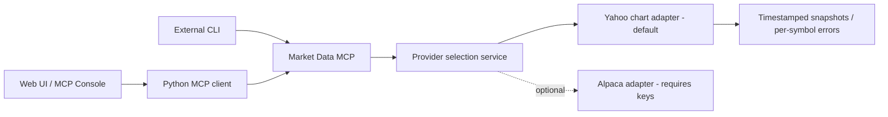

# Implementation Addendum: Market Data Provider History

Date: October 20, 2026

Latest update: November 1, 2026. Alpaca is restored as the default quote provider, reusing saved API keys and feeds. Yahoo Finance remains the news source and an explicit optional quote adapter. The October sections below record the earlier experiment and are historical, not the current provider selection.

The November configuration is `TRADING_JOURNAL_MARKET_DATA_PROVIDER=alpaca` (also the default when unset). IEX stocks have exchange-limited coverage; indicative options are labeled `INDICATIVE`. The existing MCP tools and endpoint are unchanged. See the [current market-data workflow](../market_data_workflow.md) for setup.

Project: Trading Journal MCP. Team: Deepak Singla and Ram kiran Hota.

This addendum records a change to the working application after proposal acceptance. It accompanies the accepted proposal without rewriting the submitted PDF or Word document and does not assert a new faculty approval.

## Change And Rationale

The original prototype used Alpaca market-data snapshots. The demo now selects Yahoo Finance by default so quote lookup does not require a brokerage account or API credentials. The application already used Yahoo for demo stock news, through a separate provider adapter.

This is a provider substitution behind the existing MCP interface. Clients still discover and call the same `get_market_data_capabilities`, `get_equity_snapshots`, and `get_option_snapshots` tools on `/market-data-mcp/`, read `market-data://capabilities`, and render `market_data_health_check`.

## Scope And Evidence

- Stocks and ETFs use Yahoo's latest available regular-session price and its matching source timestamp. Option chart lookup is best effort by exact contract symbol.
- Prices may be delayed. This adapter does not provide continuous exchange streaming, executable bid/ask, option chains, Greeks, individual bond quotes, or mutual-fund NAV lookup.
- Invalid or missing quotes remain unavailable rather than becoming zero. Currency mismatches block position-mark updates; the application does not convert currencies.
- Automated tests cover the provider's normalization, failure paths, audit records, MCP integration, and position refresh. The current verification record is in the [technical white paper](../mcp_use_case_white_paper.md#173-reporting-observations).
- Alpaca remains available only when explicitly selected with `TRADING_JOURNAL_MARKET_DATA_PROVIDER=alpaca`; saved credentials do not activate it.
- Provider replacement does not implement brokerage sync, paper execution, live trading, or investment recommendations.

## Production Follow-Up

Roadmap item 17 includes reviewing or replacing both unofficial Yahoo news and chart sources before production use. That review must address source terms, permitted redistribution, reliability, request limits, asset coverage, and required latency. Quote persistence and freshness policies remain part of item 7.

The [market-data workflow](../market_data_workflow.md) provides setup commands, code responsibilities, and source references. The [documentation index](../README.md) identifies current materials and historical submissions.
